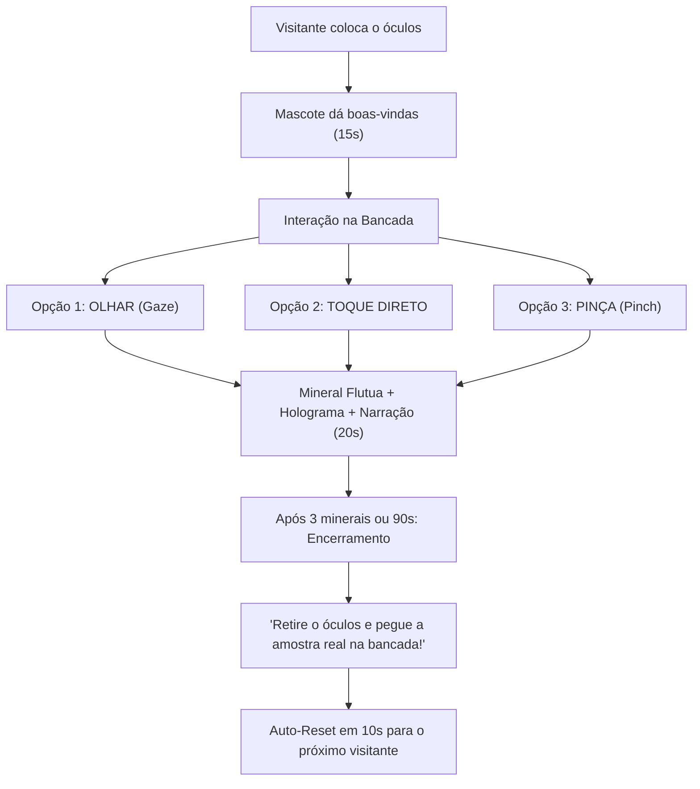

# 🥽 Guia de Instalação no Meta Quest 2 e Operação Sem Controles

Este guia explica passo a passo como compilar, instalar o aplicativo nos seus **Meta Quest 2** e como funciona a operação **100% sem controles físicos**, utilizando apenas o **olhar (Gaze)** e as **mãos reais (Hand Tracking)**.

---

## 📑 Índice
1. [Preparação do Meta Quest 2 (Modo Desenvolvedor)](#1-preparação-do-meta-quest-2-modo-desenvolvedor)
2. [Montando a Cena com 1 Clique na Unity](#2-montando-a-cena-com-1-clique-na-unity)
3. [Configuração do Hand Tracking na Unity](#3-configuração-do-hand-tracking-na-unity)
4. [Compilando e Colocando o APK no Óculos](#4-compilando-e-colocando-o-apk-no-óculos)
5. [Como Abrir o App no Meta Quest 2](#5-como-abrir-o-app-no-meta-quest-2)
6. [Como Funciona Sem Controles (Olhar e Mãos)](#6-como-funciona-sem-controles-olhar-e-mãos)
7. [Dicas de Ouro para a Equipe de Estande](#7-dicas-de-ouro-para-a-equipe-de-estande)

---

## 1. Preparação do Meta Quest 2 (Modo Desenvolvedor)

Para instalar aplicativos criados na Unity diretamente no óculos, você precisa ativar o **Modo Desenvolvedor** uma única vez em cada um dos 5 aparelhos:

1. Baixe o aplicativo **Meta Quest** no seu celular (Android ou iOS) e faça login com a conta associada aos óculos.
2. Acesse [developer.oculus.com](https://developer.oculus.com) no navegador do computador e crie uma "Organização" (basta colocar qualquer nome, ex: `CETEM-VR`).
3. No app do celular:
   - Vá em **Menu** > **Dispositivos** > Selecione o seu Meta Quest 2 conectado via Bluetooth.
   - Vá em **Configurações do Headset** > **Modo Desenvolvedor** e ative a chave.
4. Conecte o Quest 2 ao computador com um **cabo USB-C**.
5. Coloque o óculos no rosto: aparecerá uma janela perguntando **"Permitir depuração USB?"**.
   - Marque a caixa **"Sempre permitir deste computador"** e confirme.

---

## 2. Montando a Cena com 1 Clique na Unity

Criamos um assistente automatizado no projeto para você não precisar montar nada manualmente:

1. Abra o projeto na Unity (versão 2022.3 LTS recomendada).
2. Na barra de menus superior da Unity, clique em:
   - **`CETEM VR`** > **`1. Gerar Assets dos 4 Minerais (ScriptableObjects)`**
   *(Isso criará os dados de Neodímio, Lítio, Nióbio e Quartzo com cores e textos em `Assets/_Project/ScriptableObjects/`)*.
3. Em seguida, clique em:
   - **`CETEM VR`** > **`2. Montar Cena Completa (Laboratório VR)`**
4. Pronto! Uma nova cena chamada **`Capsula_Terras_Raras_CETEM.unity`** será montada com:
   - Bancada futurista do laboratório.
   - 4 pedestais com cristais flutuantes e luzes temáticas.
   - Retícula de olhar e mãos virtuais com colisão.
   - Mascote com áudio espacial 3D.
   - Máquina de estados `ExperienceManager` totalmente conectada.

---

## 3. Configuração do Hand Tracking na Unity

Para que o Meta Quest 2 reconheça as mãos reais dos visitantes e ignore os controles:

1. Na Unity, abra **`Edit` > `Project Settings` > `XR Plug-in Management`**.
2. Na aba com o ícone do **Android**, clique em **`OpenXR`**.
3. Na lista de recursos (**OpenXR Feature Groups / Features**), marque:
   - ✅ **Meta Quest Support**
   - ✅ **Hand Tracking Subsystem** (ou *Hand Tracking*)
4. Clique no ícone de engrenagem ao lado de **Meta Quest Support**:
   - Localize o campo **Hand Tracking Support** e defina como:
     - **`Controllers And Hands`** (permite alternar automaticamente) OU
     - **`Hands Only`** (força o modo 100% mãos sem nenhum controle).
5. Defina **Hand Tracking Frequency** para **`HIGH`** (para rastreamento rápido e preciso dos dedos).

---

## 4. Compilando e Colocando o APK no Óculos

Existem **3 formas fáceis** de colocar o jogo dentro dos óculos:

### Opção A: Direto pela Unity ("Build and Run") — *Mais rápida para o 1º óculos*
1. Conecte o Meta Quest 2 no computador via USB-C.
2. Na Unity, vá em **`File` > `Build Settings`**.
3. Selecione a plataforma **Android** e verifique se a cena `Capsula_Terras_Raras_CETEM` está marcada no topo.
4. No campo **`Run Device`**, selecione o seu Meta Quest (ele aparecerá como `Oculus Quest 2 [número de série]`).
5. Clique no botão **`Build and Run`**.
6. Escolha uma pasta para salvar o arquivo (ex: `Builds/CETEM_VR.apk`). A Unity compilará, transferirá para o óculos e abrirá o aplicativo automaticamente na sua frente!

### Opção B: Pelo Meta Quest Developer Hub (MQDH) ou SideQuest — *Ideal para os 5 óculos*
1. Na Unity, em `Build Settings`, clique apenas em **`Build`** para gerar o arquivo `CETEM_VR.apk`.
2. Abra o software gratuito **Meta Quest Developer Hub (MQDH)** ou o **SideQuest** no PC.
3. Conecte cada um dos óculos, um por um.
4. Arraste e solte o arquivo `CETEM_VR.apk` para dentro do programa. A instalação leva cerca de 20 segundos por aparelho!

### Opção C: Pelo Terminal / Prompt de Comando (ADB)
```bash
adb install -r Builds/CETEM_VR.apk
```

---

## 5. Como Abrir o App no Meta Quest 2

Depois que o APK foi instalado no óculos:

1. Coloque o Meta Quest 2 no rosto.
2. No menu principal da barra inferior, clique no ícone da **Biblioteca de Aplicativos** (ícone de grade de 9 pontinhos).
3. No canto superior direito da janela de apps, onde diz **"Tudo" (All)**, clique na seta do menu suspenso.
4. Role até o final e selecione a categoria **"Fontes Desconhecidas" (Unknown Sources)**.
5. Você verá o aplicativo **`Cápsula das Terras Raras`** (ou o package name do projeto). Basta clicar nele para entrar na experiência!

---

## 6. Como Funciona Sem Controles (Olhar e Mãos)

Em eventos públicos com filas e grande rotatividade, **eliminar os controles físicos traz grandes vantagens**:
- Zero risco de controles caírem no chão e quebrarem.
- Zero perda de tempo trocando pilhas AA no meio da feira.
- Higienização muito mais rápida (apenas a espuma do visor).
- Acessibilidade total: qualquer criança ou adolescente compreende a mecânica instantaneamente.

### Como o visitante interage:



1. **Interação pelo Olhar (Gaze Dwell - 2 Segundos):**
   - O visitante não precisa mover as mãos. Basta olhar para qualquer um dos 4 cristais na bancada.
   - Uma retícula circular suave no centro da visão se preenche ao longo de **2 segundos**.
   - Ao completar o círculo, o cristal se eleva, acende sua cor temática, o holograma 3D surge e o mascote explica a aplicação científica.

2. **Interação por Mãos Reais (Hand Tracking):**
   - **Toque Físico Direto:** Como a bancada virtual fica bem à frente do visitante na altura da cintura/peito, ele pode simplesmente estender a mão real e encostar o dedo no cristal. O toque aciona o mineral na mesma hora!
   - **Gesto de Pinça (Pinch):** O visitante pode apontar a mão para o mineral e unir a ponta do polegar com o indicador (pinça). O mineral é ativado à distância sem precisar esperar os 2 segundos.

---

## 7. Dicas de Ouro para a Equipe de Estande

- **Guarde os controles:** Retire as pilhas dos controles do Quest 2 e guarde-os na gaveta do estande. Quando o óculos não encontra os controles ligados, ele ativa o modo mãos automaticamente!
- **Sistema Guardião:** Configure o Guardião do Quest 2 como **"Estacionário" (Sentado/Parado)** no local exato onde o jovem ficará posicionado em frente à bancada física.
- **Instrução rápida para a fila:** Diga ao visitante antes de colocar o óculos:  
  *"Basta colocar o óculos e olhar fixamente por dois segundos para a pedra que você quiser conhecer, ou esticar a mão para tocá-la!"*
- **Ponte com a Bancada Real (O grande diferencial do CETEM):**  
  Deixe 4 pedras reais na mesa do estande (Neodímio, Espodumênio/Lítio, Pirocloro/Nióbio e Quartzo). Quando o visitante terminar o VR e ouvir a mensagem final, entregue na mão dele a pedra correspondente para ele sentir o peso e a textura real!

