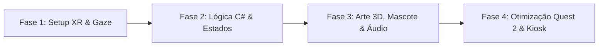

# 📋 Planejamento e Roteiro - Cápsula das Terras Raras (CETEM VR)

Este documento detalha o cronograma de engenharia em 4 fases e o roteiro completo de falas e direção audiovisual do Mascote do CETEM para a experiência em Realidade Virtual.

---

## 🗺️ Roadmap de Desenvolvimento (4 Fases)

### Fase 1: Setup XR, Pipeline URP e Interação por Olhar (Gaze)
- [ ] Criação do projeto na **Unity 2022.3 LTS** utilizando template **3D (URP)**.
- [ ] Configuração do **OpenXR** para Android (Meta Quest 2) com *Single Pass Instanced Rendering*.
- [ ] Configuração do `XR Origin (VR)` em modo `Floor` ou `Device` estacionário.
- [ ] Implementação da câmera central com Raycast (`Gaze Ray`) e **UI Reticle Radial** (Canvas World Space fixado a `1.5m` da câmera com `Image.fillAmount`).
- [ ] Teste de protótipo (Greybox) com 4 cubos representando os pedestais na bancada a uma distância ergonômica de visão (ângulo horizontal máximo de $\pm 45^\circ$ para evitar torção excessiva do pescoço).

### Fase 2: Arquitetura C# e Máquina de Estados
- [x] Criação do ScriptableObject [`MineralData.cs`](file:///c:/Users/jsdias/Documents/CODIGOS/oculos/Assets/_Project/Scripts/MineralData.cs) para desacoplar dados de conteúdo da lógica de programação.
- [x] Implementação do componente [`GazeInteractableMineral.cs`](file:///c:/Users/jsdias/Documents/CODIGOS/oculos/Assets/_Project/Scripts/GazeInteractableMineral.cs) com detecção de olhar por `2.0s`, feedback visual/sonoro e bloqueio durante narrações ativas.
- [x] Implementação do controlador central [`ExperienceManager.cs`](file:///c:/Users/jsdias/Documents/CODIGOS/oculos/Assets/_Project/Scripts/ExperienceManager.cs) gerenciando os 4 estados do ciclo de vida:
  1. `IdleWaitingUser` (Aguardando visitante olhar para o centro / iniciar)
  2. `IntroMascot` (Boas-vindas de 15s com bloqueio temporário dos cristais)
  3. `InteractiveExploration` (Timer global de 90s ou limite de 3 minerais explorados)
  4. `OutroReset` (Mensagem de encerramento e auto-reset em 10s)
- [x] Implementação do utilitário [`FloatingRotator.cs`](file:///c:/Users/jsdias/Documents/CODIGOS/oculos/Assets/_Project/Scripts/FloatingRotator.cs) para movimentação orgânica dos minérios e hologramas.

### Fase 3: Arte 3D, Mascote, Hologramas e Áudio Espacial
- [ ] Modelagem e texturização do ambiente do **Laboratório Futurista CETEM** (otimizado com *Baked Lightmaps*).
- [ ] Modelagem dos **4 Cristais/Minérios** com materiais distintos (brilho metálico para Nióbio, cristalino translúcido para Quartzo, rocha com veios brilhantes para Neodímio e Lítio).
- [ ] Criação dos **4 Prefabs de Hologramas de Aplicação** (Shader fresnel aditivo ciano/azul):
  - *Neodímio:* Turbina eólica girando + fone de ouvido com ondas sonoras.
  - *Lítio:* Bateria energética carregando + carro elétrico estilizado.
  - *Nióbio:* Foguete espacial / turbina aeronáutica com escudo térmico.
  - *Quartzo/Silício:* Placa solar absorvendo fótons + processador de computador.
- [ ] Integração do **Mascote 3D do CETEM** com animações: `Idle`, `Talking_Welcome`, `Pointing_Bench`, `Talking_Explain` e `Waving_Goodbye`.
- [ ] Gravação e normalização das faixas de voz (`.wav`, 44.1kHz, Mono para posicionamento 3D espacial).

### Fase 4: Otimização Meta Quest 2, Testes de Fila e Modo Quiosque (Kiosk)
- [ ] **Baking de Iluminação:** Configurar todas as luzes do cenário como `Baked` (deixando apenas 1 Directional Light `Mixed` ou `Baked` e MatCaps nos cristais) para manter `< 80 Draw Calls` e `72 FPS / 90 FPS` constantes.
- [ ] **Prevenção de Hibernação:** Configurar `Screen.sleepTimeout = SleepTimeout.NeverSleep` e ajustar o sensor de proximidade dos 5 Meta Quest 2 (ou usar fita protetora/configuração via SideQuest/ADB se desejado manter ligado continuamente).
- [ ] **Configuração de Kiosk Mode Android:** Utilizar inicializador automático ou bloqueio de botão Home para impedir que visitantes saiam do aplicativo acidentalmente.
- [ ] Instalação simultânea via ADB (`adb install -r CETEM_VR.apk`) nas 5 unidades do Meta Quest 2.

---

## 🎙️ Roteiro de Falas do Mascote CETEM

> [!TIP]
> **Direção de Locução:** Tom jovem, dinâmico, curioso e acolhedor. Ritmo ágil de divulgação científica (estilo *TikTok/Reels de Ciência*), sem jargões excessivamente acadêmicos.

### 1. Abertura / Boas-Vindas (`IntroMascot` — ~15 segundos)
> **Animação do Mascote:** Acena animado no centro da bancada e aponta para os 4 pedestais iluminados.
>
> **Fala:**
> *"Olá! Que incrível ter você aqui na Cápsula do CETEM, o Centro de Tecnologia Mineral! Sabe o seu celular, os jogos e a energia limpa do futuro? Tudo isso começa dentro das rochas! Olhe fixamente por dois segundos para qualquer um dos cristais aqui na bancada para descobrir os superpoderes dele!"*

---

### 2. Minerais na Bancada (`InteractiveExploration` — ~20 segundos cada)

#### 🧲 Pedestal 1: Neodímio (Terras Raras)
- **Símbolo Químico:** $\text{Nd}$ (Número Atômico 60)
- **Cor de Destaque:** `#00F0FF` (Ciano Elétrico)
- **Holograma:** Fone de ouvido + Turbina Eólica girando.
- **Fala (~20s):**
  > *"Esse é o Neodímio, um dos famosos elementos das Terras Raras estudados aqui no CETEM! Ele cria os ímãs permanentes mais fortes do planeta! É graças a ele que o fone de ouvido cabe na sua orelha com um som potente e que as gigantescas turbinas eólicas geram energia limpa com a força do vento!"*

#### ⚡ Pedestal 2: Lítio (Transição Energética)
- **Símbolo Químico:** $\text{Li}$ (Número Atômico 3)
- **Cor de Destaque:** `#39FF14` (Verde Neon Energético)
- **Holograma:** Bateria em recarga rápida + Veículo Elétrico.
- **Fala (~20s):**
  > *"Você escolheu o Lítio, o metal mais leve do universo e o coração da transição energética! Sem o Lítio processado com tecnologia mineral, não existiriam baterias recarregáveis de longa duração para o seu smartphone, notebooks ou para os ônibus e carros elétricos que não poluem as nossas cidades!"*

#### 🚀 Pedestal 3: Nióbio (Superligas e Tecnologia Espacial)
- **Símbolo Químico:** $\text{Nb}$ (Número Atômico 41)
- **Cor de Destaque:** `#9D4EDD` (Roxo/Violeta Metálico)
- **Holograma:** Foguete espacial / Satélite e ponte estaiada.
- **Fala (~20s):**
  > *"Olha só o Nióbio! O Brasil é o maior produtor mundial desse mineral estratégico! Basta adicionar uma pitada de Nióbio no aço para deixá-lo super-resistente, leve e capaz de suportar temperaturas extremas. Ele está em turbinas de aviões, pontes gigantes e até nos foguetes que vão para o espaço!"*

#### ☀️ Pedestal 4: Quartzo / Silício de Alta Pureza (Semicondutores e Energia Solar)
- **Símbolo Químico:** $\text{SiO}_2 / \text{Si}$
- **Cor de Destaque:** `#FFB703` (Dourado Solar)
- **Holograma:** Painel Fotovoltaico + Microchip de Computador.
- **Fala (~20s):**
  > *"Esse cristal brilhante é o Quartzo! Quando purificado em laboratório, extraímos dele o Silício de alta pureza. Ele faz duas mágicas da tecnologia moderna: transforma a luz do sol diretamente em eletricidade nos painéis solares e forma o cérebro de bilhões de microchips dentro dos computadores e inteligência artificial!"*

---

### 3. Encerramento e Chamada para o Mundo Real (`OutroReset` — ~10 segundos)
> **Gatilho:** Disparado automaticamente ao atingir **90 segundos** na fase de exploração **OU** assim que o visitante terminar de ouvir o **3º mineral**.
>
> **Animação do Mascote:** Comemora e aponta para fora (em direção ao mundo real). Um painel visual amigável aparece no centro da visão.
>
> **Fala:**
> *"Experiência concluída! Você mandou muito bem no laboratório! Agora, retire os óculos com cuidado e pegue aí na bancada real a amostra verdadeira do minério que você acabou de conhecer! Até a próxima!"*

